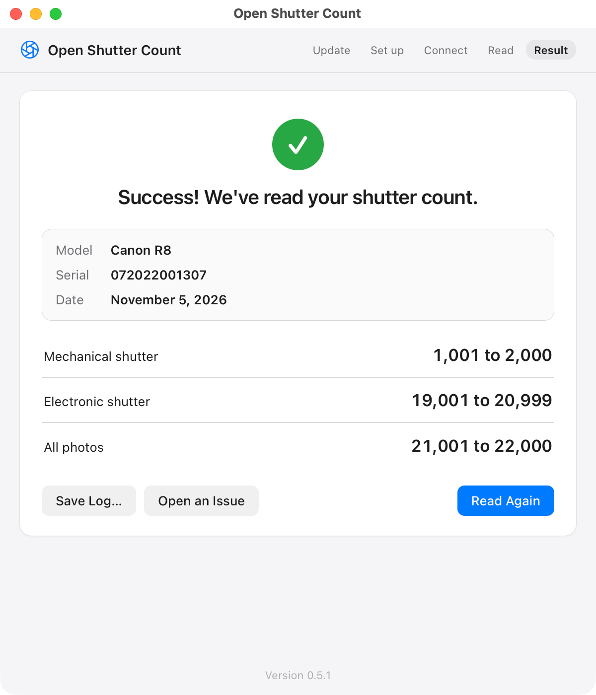

# Open Shutter Count

A small Mac app that reads your Canon camera's shutter count over USB, step by step.
Free and open source.

**[Download the latest version](https://github.com/DigitalN/openshuttercounter/releases/latest)**
(for Macs with Apple silicon)

  

- **Read off the camera itself.** Some online tools read from a photo file. The mechanical count
  is kept inside the camera, and this reads it from there.
- **Guided walkthrough experience.** It checks the camera is set up, waits for it, reads it, and
  says what it found, or what to do if it couldn't.

## Cameras

**Tested**

| Camera | What it reads |
|---|---|
| Canon R8 | Mechanical and electronic shot counts, kept separate. Each to within a thousand, as the camera only keeps them that way. |
| Canon EOS 5D Mark IV | Exact shutter and mirror counts. |

**Should work, but not 100% confirmed**

| Camera | What it reads |
|---|---|
| Other EF DSLRs that list Canon's factory channel (7D Mark II, 5DS R, 80D, 77D and so on) | Read the way the 5D Mark IV is |
| RF bodies, and newer bodies that report the R8's counter (90D, EOS M50 Mark II, M6 Mark II) | Read the way the R8 is |
| Anything else | Can't be read yet. Click Open an Issue in the app, and it can be worked out. |

## Install

1. **Download** `Open-Shutter-Count-….dmg` from the
   [latest release](https://github.com/DigitalN/openshuttercounter/releases/latest) and
   open it.
2. **Drag Open Shutter Count into Applications**, as the arrow shows.
3. **Open it** from Applications.

The first time you open it, macOS may say it can't verify Open Shutter Count. Click
**Done**, then go to **System Settings › Privacy & Security**, scroll down, and click
**Open Anyway**. You only do this once: Open Shutter Count isn't tied to a paid
developer account so this step is required.

Each time it opens it installs a new version if there is one, and reopens.
This allows us to quickly test new cameras as they are added.

## Reading a camera

1. Open the app.
2. Set up the camera as the checklist says: USB connection set to **Photo Import/Remote
   Control** (on the Canon R8: MENU › Setup (wrench) › page 4 › Choose USB connection
   app), Wi-Fi and Bluetooth off, a card in, plugged straight into the Mac with a data
   cable, and Image Capture, Photos and EOS Utility closed.
3. Switch the camera on and plug it in. On a Mac laptop, click
   **Allow** if macOS asks whether the accessory can connect.
4. It reads the camera and shows the counts, with the camera's model, its serial number
   and the date above them, ready to screenshot for an ad if you're selling it.

If it couldn't read your camera, or the numbers look wrong, click **Open an Issue**. It opens
a new GitHub issue with the log filled in, for you to look over before you submit it.

## Privacy

- **The only connection is the update check**: each time it opens, it asks GitHub for
  the latest release. It only installs updates signed by the same developer. No
  analytics, crash reports or web servers.
- **The log only goes where you send it**: Save Log saves it where you choose, and Open an
  Issue sends it to GitHub to fill in a new issue, which isn't posted until you submit it. It
  has the camera's model, firmware and what it answered, your Mac's model and macOS
  version, and nothing that identifies you or your camera: no serial number, owner or
  copyright name.
- **The serial number is only on the screen**: the result screen shows the one on the
  camera's body, for a screenshot. It isn't in the log or the issue.
- **Nothing is left behind**: no log file, no preferences, no saved window, and the
  update download is deleted. macOS keeps its own records, such as the accessory
  approval and Open Anyway.

## Credit

Started from Maxime Visonneau's openshuttercounter, which worked out Canon's factory
channel. The work it built on is credited in
[docs/PROTOCOL.md](docs/PROTOCOL.md#prior-work). The app's updater, look and packaging
come from [Mac Engine Room](https://github.com/DigitalN/mac-engine-room). What's
bundled with it, and their licenses, are in [THIRD-PARTY-NOTICES](docs/THIRD-PARTY-NOTICES).

## License

MIT. See [LICENSE](LICENSE).
